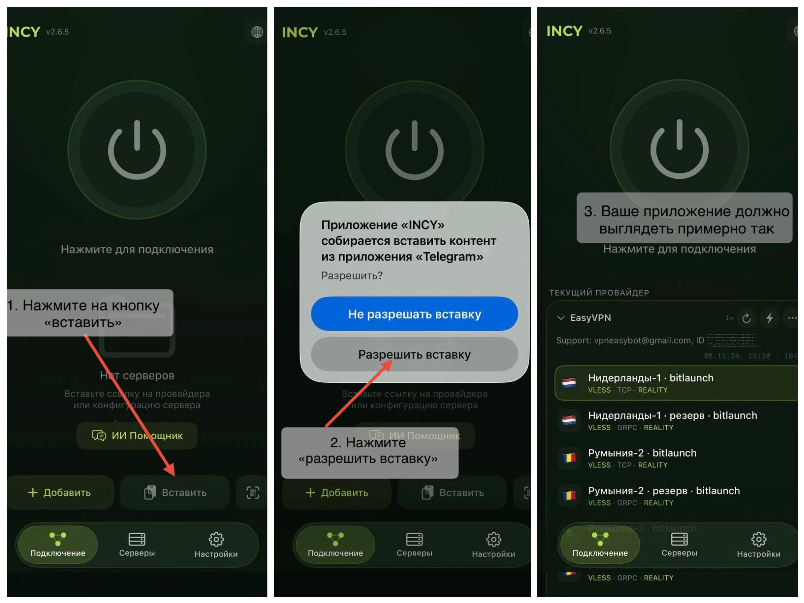
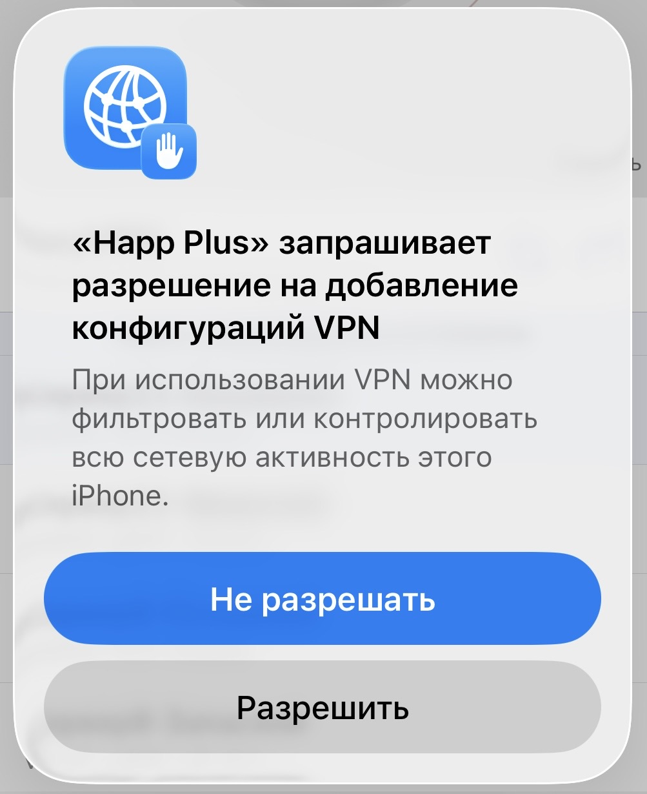

# 🔐 Подключение VPN за 2 минуты

Просто выполните шаги ниже — это проще, чем кажется 👇

---
### Шаг 1 — Установить приложение
Выберите ваше устройство и установите приложение:
- 🍎 iPhone / iPad / Mac → [ссылка](https://apps.apple.com/ru/app/incy/id6756943388)
- 🤖 Android → [ссылка](https://play.google.com/store/apps/details?id=llc.itdev.incy&hl=ru)
- 💻 Windows → [ссылка](https://github.com/Happ-proxy/happ-desktop/releases/latest/download/setup-Happ.x64.exe)

💡 Мы рекомендуем пользоваться приложениями по ссылкам выше, но вы можете использовать и другие приложения. Для нашего vpn подходят:
- incy
- Happ
- v2RayTun
- Streisand
- Hiddify

### Шаг 2 — Получить ключ
Если у вас еще нет своего ключа, то:
1. Откройте нашего бота @vpn_easy_bot в Telegram через поиск по названию или по [ссылке](https://t.me/vpn_easy_bot?start=0) (к сожалению, стать пользователем нашего vpn сейчас можно только имея доступ в telegram).
2. Отправьте команду `/start`, получите ключ.
3. Скопируйте его ПОЛНОСТЬЮ.

### Шаг 3 — Добавить ключ
🚨 Важно:

- Перед этим удалите старые ключи
- Ключ должен быть скопирован полностью
- Убедитесь, что у вас хорошее интернет-соединение

Инструкция:

1. Нажмите кнопку "Вставить"
2. Разрешите вставку
3. Убедитесь, что у вас несколько серверов и есть надпись "EasyVPN", это будет означать, что ключ вставлен верно

   ### INCY
   Инструкция для других приложений [тут](instructions.md)
   
   

### Шаг 4 — Подключитесь
1. Выберите любой сервер из списка
2. Нажмите кнопку запуска

Если ранее вы не запускали используемое приложение, то у вас может появиться подобное сообщение, нажмите "Разрешить"

   
🎉 Готово 🎉

💡 Если не работает — попробуйте другой сервер

---

## ⚠️ ВАЖНО

Обязательно:

- ##### Удаляйте старые ключи перед добавлением нового
- ##### Всегда выбирайте сервер перед запуском
- ##### Если не работает — попробуйте другой сервер

---

## ❗ Возникли проблемы?
Если что-то не работает — посмотрите [раздел с решениями](faq.md)
